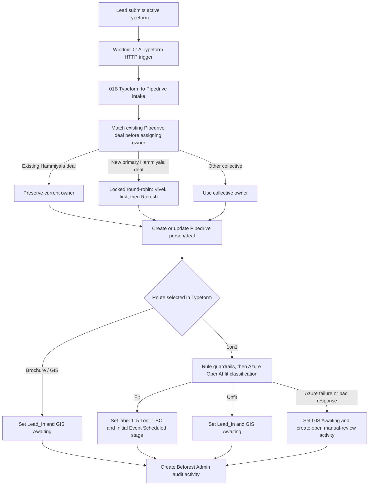
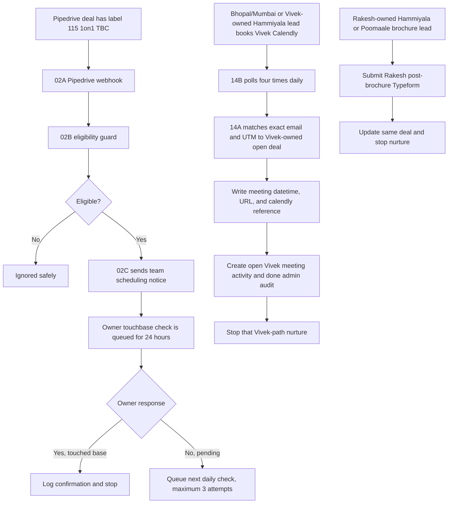
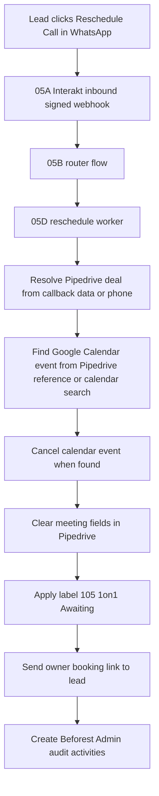
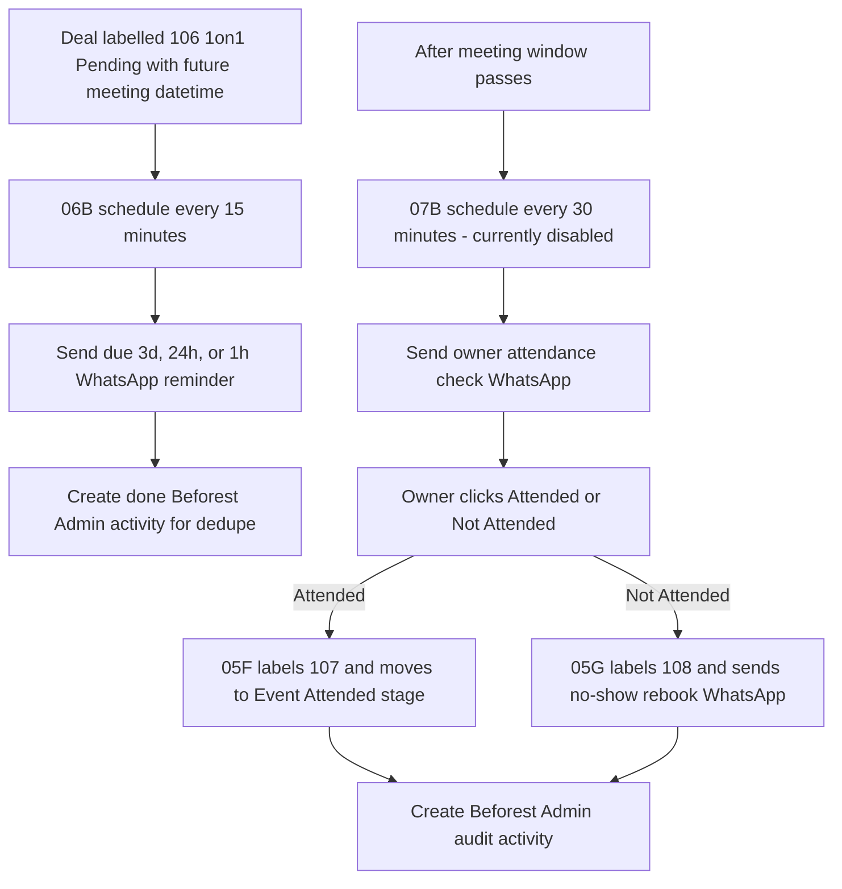
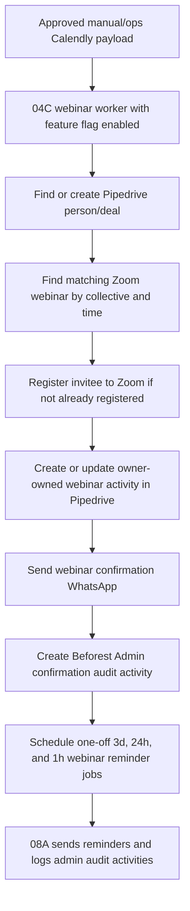

# 01 System Overview

This document explains the sales automation flow in business terms. See [02 Automation Reference](02_automation_reference.md) for exact Windmill paths.

## Systems Involved

| System | Role |
| --- | --- |
| Typeform | Primary collective intake plus the Hammiyala/Poomaale post-brochure conversation-request forms. |
| Windmill | Automation runtime and orchestrator. |
| Pipedrive | CRM source of truth for people, deals, labels, stages, notes, and activities. |
| Azure OpenAI | Fit/unfit classification for 1on1 requests after deterministic fit/unfit guardrails. |
| Google Calendar | Legacy/internal calendar-prebook tooling and calendar operations for already-booked meetings; it is not the default fit-lead path. |
| Calendly | Vivek's live booking destination for Bhopal/Mumbai and, after the pending split deployment, Vivek-owned Hammiyala brochure leads; also a gated source for legacy webinar operations. |
| Zoom | Webinar registration system. |
| Interakt | WhatsApp templates, buttons, reminders, and inbound message webhooks. |

## Owner Routing

| Collective | Owner | Pipedrive owner ID | Brochure next step | Nurture stops when |
| --- | --- | --- | --- | --- |
| Bhopal | Vivekanand | `22251956` | Vivek Calendly with `utm_campaign=bhopal` | A confident Calendly booking is synced to the open Bhopal deal |
| Mumbai | Vivekanand | `22251956` | Vivek Calendly with `utm_campaign=mumbai` | A confident Calendly booking is synced to the open Mumbai deal |
| Hammiyala — Vivek turn | Vivekanand | `22251956` | Vivek brochure → Calendly with `utm_campaign=hammiyala` | A confident Calendly booking is synced to the open Vivek-owned Hammiyala deal |
| Hammiyala — Rakesh turn | Sai Rakesh | `13490118` | Rakesh brochure → post-brochure Typeform | The post-brochure Typeform is submitted |
| Poomaale 2.0 | Sai Rakesh | `13490118` | Rakesh's post-brochure Typeform | The post-brochure Typeform is submitted |

## Route A: Typeform To Pipedrive

Important rule: if Azure classification fails, Windmill does not silently schedule a 1on1. The deal follows the GIS/brochure route.

Important rule: obvious greeting/filler 1on1 reasons such as `Hi` are unfit, while ready/near-ready clarification answers and specific commercial/legal/visit/booking questions are fit before Azure is called.

## Route B: Current Scheduling Paths

`f/sales/calendar_prebook_1on1` remains available for controlled internal/manual use, but `02B` no longer calls it for fit intake leads.

## Route C: Reschedule Button

## Route D: 1on1 Reminder And Attendance Loop

## Route E: Gated Legacy Webinar Booking To Zoom And Reminders

## Pipedrive Labels Used

| Label ID | Meaning | Used by |
| --- | --- | --- |
| `105` | 1on1 Awaiting | Reschedule flow and no-slot fallback |
| `106` | 1on1 Pending | Lead confirmed attendance; reminder and owner-check loop |
| `107` | 1on1 Attended | Owner marked attended |
| `108` | 1on1 No Show | Owner marked not attended |
| `110` | Scheduled Webinar Awaiting | Legacy/gated webinar route |
| `111` | Scheduled Webinar Pending | Legacy/gated webinar booking/reminder route |
| `115` | 1on1 TBC | Fit lead awaiting team-managed scheduling |

